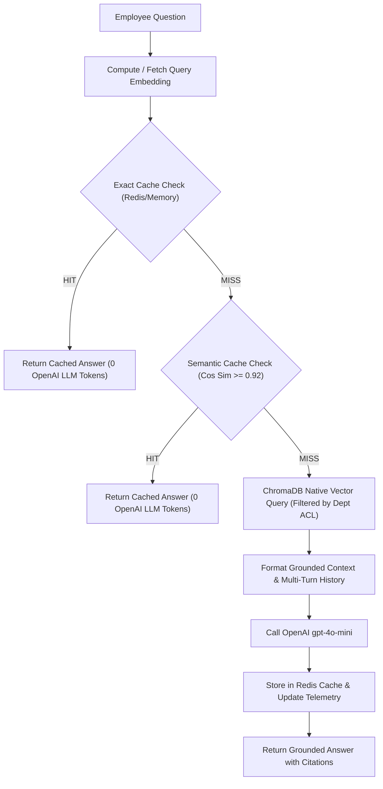

# Production Company RAG Assistant

An enterprise-ready, cost-optimized Retrieval-Augmented Generation (RAG) assistant designed for internal company knowledge management, policy Q&A, and department-isolated document intelligence. Built with Flask, ChromaDB native indexed vector search, Redis multi-tiered semantic caching, and OpenAI (`gpt-4o-mini` and `text-embedding-3-small`).

---

## 🌟 Key Capabilities & Features

1. **Company-Specific AI Grounding & Strict Anti-Hallucination**:
   - Dedicated configurable company persona via `prompts/company_system_prompt.py`.
   - Answers strictly and exclusively from retrieved company documents.
   - Refuses to invent facts, policies, or figures when information is unavailable.
   - Every answer includes exact source document citations, department ownership, and matching confidence.

2. **Native ChromaDB Vector Storage & Smart Document Management**:
   - Supports `.pdf`, `.docx`, and `.txt` files up to 16MB.
   - Department tagging (`ALL`, `HR`, `IT`, `FIN`, `SALES`) for strict access segregation.
   - Deterministic SHA-256 chunk hashing preventing duplicate chunk generation on re-uploads.
   - ChromaDB native indexed vector querying (`hnsw:space: cosine`) with server-side metadata filtering.

3. **Multi-Tiered Redis Cost Optimization Engine**:
   - **Embedding Cache**: Hashes raw text to retrieve precomputed embeddings, eliminating duplicate OpenAI embedding calls.
   - **Exact Question Cache**: O(1) Redis lookup for repeated inquiries.
   - **Semantic Similarity Cache**: Uses cosine similarity between query embeddings (configurable threshold `0.92`) to serve answers for semantically equivalent questions without invoking OpenAI completion models.
   - **Department ACL Cache Isolation**: Prevents unauthorized data exposure by partitioning cached answers by user department authorization, prompt version, and knowledge-base version (`kb_version`).
   - **Automatic Cache Invalidation**: Modifying or deleting documents bumps the `kb_version` and purges stale answers.
   - **Zero-Failure Fallback**: If Redis is offline, the system seamlessly falls back to an in-memory thread-safe LRU cache without interrupting service.

4. **Multi-Turn Conversation Memory**:
   - Redis-backed conversation memory (configurable 8 turns) maintaining context across follow-ups ("Explain this again", "What is its eligibility criteria?").
   - Strict session isolation ensuring distinct users and browser tabs never cross-contaminate context.

5. **Role-Based Access Control (RBAC) & Security**:
   - Department-level server-side ACL enforcement.
   - Demo role switcher supporting `admin`, `hr_lead`, `it_specialist`, `finance_analyst`, and standard `employee`.
   - Never trusts frontend parameter values; permissions are validated server-side against authenticated sessions.

6. **Real-Time Cost & Telemetry Dashboard**:
   - Live telemetry tracking Cache Hits (Exact & Semantic), Cache Misses, Hit Rate %, Cumulative Tokens Used, and Total Estimated OpenAI API Cost Saved.

---

## 🏗️ Project Architecture

```
Production-RAG-Application/
├── app.py                         # Application entrypoint & Flask REST routes
├── config.py                      # Centralized enterprise configuration & RBAC definitions
├── requirements.txt               # Production dependencies (Flask, ChromaDB, Redis, TikToken, etc.)
├── .env.example                   # Environment variable template
├── prompts/
│   ├── __init__.py
│   └── company_system_prompt.py   # Configurable enterprise persona & grounded RAG templates
├── services/
│   ├── __init__.py                # Clean export of all modular services
│   ├── document_service.py        # PDF/DOCX/TXT parsing, chunking, hashing & deduplication
│   ├── embedding_service.py       # OpenAI text-embedding-3-small + embedding caching layer
│   ├── retrieval_service.py       # ChromaDB native indexed retrieval + server-side ACL filtering
│   ├── cache_service.py           # Multi-tiered Redis exact & semantic cache + in-memory fallback
│   ├── memory_service.py          # Session-isolated multi-turn conversation memory
│   └── llm_service.py             # Grounded gpt-4o-mini completion, token & cost tracking
├── templates/
│   ├── index.html                 # Production UI with Chat, Document Management & Telemetry
│   └── login.html                 # Enterprise login & demo role selection page
├── static/
│   └── style.css                  # Modern responsive styling & card layouts
└── tests/
    ├── conftest.py                # Mock fixtures & in-memory test harness
    ├── test_document_service.py   # Document parsing, validation & deduplication tests
    ├── test_cache_service.py      # Exact, semantic, ACL isolation & invalidation tests
    ├── test_retrieval_and_acl.py  # ChromaDB indexing, native query & department filtering tests
    ├── test_memory_service.py     # Conversation memory turn limits & session isolation tests
    └── test_api_routes.py         # End-to-end Flask endpoint & route integration tests
```

---

## ⚙️ Environment Variables

Create a `.env` file in the project root based on `.env.example`:

| Variable | Description | Default |
| :--- | :--- | :--- |
| `OPENAI_API_KEY` | Your OpenAI API key (**Required**) | `None` |
| `COMPANY_NAME` | Name of your company | `Enterprise Global Corp` |
| `COMPANY_ROLE` | Assistant identity & role | `Internal Company AI Assistant` |
| `RESPONSE_STYLE` | Tone and format guidelines | `professional, concise, structured` |
| `OPENAI_CHAT_MODEL`| Model for grounded answers | `gpt-4o-mini` |
| `OPENAI_EMBEDDING_MODEL` | Embedding model | `text-embedding-3-small` |
| `REDIS_URL` | Redis connection URL | `redis://localhost:6379/0` |
| `ENABLE_CACHE` | Enable/disable answer caching | `true` |
| `CACHE_TTL_SECONDS` | Cache expiration time | `86400` (24 hours) |
| `SEMANTIC_CACHE_THRESHOLD` | Cosine similarity threshold for semantic hit | `0.92` |
| `MAX_MEMORY_TURNS` | Number of previous turns remembered | `8` |
| `TOP_K_RETRIEVAL` | Chunks retrieved per query | `4` |
| `MIN_CONFIDENCE_SCORE` | Minimum vector similarity threshold | `0.35` |

---

## 🚀 Installation & Setup

### 1. Clone the Repository
```bash
git clone https://github.com/sameerrajbhar7-collab/Production-RAG-Application.git
cd Production-RAG-Application
```

### 2. Create and Activate Virtual Environment
```bash
# Windows
python -m venv venv
.\venv\Scripts\activate

# macOS / Linux
python3 -m venv venv
source venv/bin/activate
```

### 3. Install Dependencies
```bash
pip install -r requirements.txt
```

### 4. Setup Redis (Optional but Recommended)
The application connects to Redis for distributed caching and conversation memory. If Redis is not running, the application will automatically fall back to an internal thread-safe in-memory cache.

- **Local Docker Redis**:
  ```bash
  docker run -d --name redis-cache -p 6379:6379 redis:alpine
  ```
- **Native Redis (Linux/macOS)**:
  ```bash
  sudo apt-get install redis-server && sudo service redis-server start
  ```

### 5. Configure Credentials
```bash
cp .env.example .env
# Edit .env and insert your valid OPENAI_API_KEY
```

### 6. Run the Application
```bash
python app.py
```
Visit `http://localhost:8000` in your web browser.

---

## 🔒 Role-Based Access Control (RBAC) & Demo Accounts

The application includes pre-configured demo users to test server-side department isolation:

| Username | Role | Department Authorization | Access Scope |
| :--- | :--- | :--- | :--- |
| `admin` | System Administrator | `ALL`, `HR`, `IT`, `FIN`, `SALES` | Full access to all documents |
| `hr_lead` | HR Manager | `ALL`, `HR` | Company handbook + HR leave policies |
| `it_specialist` | IT Support Lead | `ALL`, `IT` | Company handbook + IT security & VPN guides |
| `finance_analyst` | Financial Analyst | `ALL`, `FIN` | Company handbook + travel & expense policies |
| `employee` | General Staff | `ALL` | Company handbook & general policies only |

You can switch users on the fly using the **Role Switcher** in the top navigation bar or by navigating to `/login`.

---

## 📄 Managing Company Documents

1. Open the **Documents** tab in the sidebar navigation.
2. Select your document (`.pdf`, `.docx`, `.txt`).
3. Choose the target **Department ACL**:
   - `ALL`: Visible to all employees.
   - `HR`: Visible only to HR and Administrators.
   - `IT`: Visible only to IT and Administrators.
   - `FIN`: Visible only to Finance and Administrators.
   - `SALES`: Visible only to Sales and Administrators.
4. Click **Upload & Process Document**.
5. The document is validated, extracted, split into semantically coherent chunks, hashed via SHA-256 (preventing duplicate chunks), and indexed directly into ChromaDB.
6. To remove a document and delete its indexed vectors, click the **Delete** icon next to the file.

---

## ⚡ How Multi-Tiered Caching Works



- Every cache entry is isolated by `(allowed_departments, model, prompt_version, kb_version)`.
- If an employee without `FIN` access asks a question answered by a finance policy, the cache returns a MISS and ChromaDB restricts retrieval to only their authorized departments.

---

## 🧪 Running the Test Suite

The comprehensive automated test suite uses `pytest` and mocks OpenAI API calls to test all functionality without generating OpenAI API costs:

```bash
# Run all tests
pytest tests -v

# Run specific test modules
pytest tests/test_retrieval_and_acl.py -v
pytest tests/test_cache_service.py -v
pytest tests/test_document_service.py -v
pytest tests/test_memory_service.py -v
pytest tests/test_api_routes.py -v
```

All 20 test suites cover:
- Document extraction, validation, and chunk deduplication hashing.
- Native ChromaDB HNSW vector indexing and cosine search.
- Department ACL enforcement (verifying IT users cannot access HR/Finance documents).
- Multi-tier exact and semantic question cache hits and misses.
- Department ACL cache isolation and cache invalidation on doc deletion.
- Multi-turn conversation memory isolation and turn rollover.
- End-to-end Flask routes (`/`, `/ask`, `/switch_user`, `/reset_conversation`, `/metrics`, `/health`).

---

## 🚢 Deployment

### Docker Deployment
Build and run using the included Docker configuration:

```bash
# Build the Docker image
docker build -t production-rag:latest .

# Run with Redis
docker run -d --name redis-server -p 6379:6379 redis:alpine
docker run -d --name rag-app -p 8000:8000 \
  -e OPENAI_API_KEY="your_api_key" \
  -e REDIS_URL="redis://redis-server:6379/0" \
  production-rag:latest
```

### AWS EC2 / Linux Server Deployment
1. Pull the repository on your EC2 instance.
2. Install Python 3.11+, pip, and Redis.
3. Configure your systemd service or use Docker Compose.
4. Ensure Port 8000 is open in your AWS Security Group.

---

## 📜 License
Internal Enterprise Use — All Rights Reserved.
